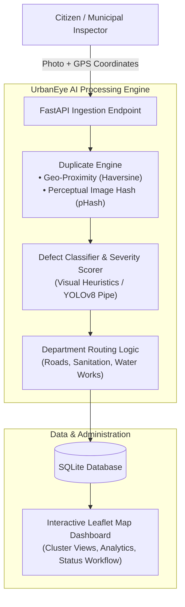

# 👁️ UrbanEye AI — Smart Civic Infrastructure & Anomaly Reporting

[](https://www.python.org/)
[](https://fastapi.tiangolo.com/)
[](https://opencv.org/)
[](https://leafletjs.com/)
[](https://www.sqlite.org/)

An intelligent civic issue reporting and municipal dispatch platform: citizens/inspectors capture civic damage (potholes, cracks, waterlogging, illegal dumps) &rarr; the system classifies the defect, scores severity, filters geospatial & perceptual duplicates, and routes tasks automatically to municipal departments on an interactive live map.



## What's real vs. what's a placeholder

| Component | Status |
|---|---|
| API (FastAPI), database, routing logic, severity scoring | ✅ Real, fully working |
| Duplicate detection (perceptual hash + geo-proximity) | ✅ Real, fully working |
| Map dashboard, upload flow, analytics, status workflow | ✅ Real, fully working |
| Image classification | ⚠️ **Placeholder heuristic** — see below |

**Why the classifier is a placeholder:** training a real YOLOv8 model needs a
labeled pothole/garbage/crack dataset and a GPU, neither of which exist in
this build environment. Building a fake "trained model" would be dishonest
and would fall apart the moment a judge asks a technical question about it.

Instead, `backend/app/ml/inference.py` implements the exact interface a real
model would have (same input, same output shape: category + confidence +
box_area_ratio), driven by real pixel statistics from the uploaded photo
(brightness, blue/green channel dominance, edge density) so the demo reacts
sensibly to real photos rather than being pure random noise — a dark/gray
textured photo scores as pothole/crack, a blue-heavy photo scores as
waterlogging, etc. **The moment your team trains the real YOLOv8n model per
the original dev guide, swap it in — the docstring at the top of
`inference.py` shows exactly where the 5 lines go, and nothing else in the
app needs to change.**

Be upfront about this with judges. It's a defensible, common hackathon
pattern (mock the model, wire the real pipeline, swap in the trained model
when ready) — and it's much better received than an over-claimed "trained
CV model" that can't survive a follow-up question.

## Quickstart

```bash
cd backend
python3 -m venv venv && source venv/bin/activate
pip install -r requirements.txt

python seed.py              # populates ~35 demo reports so the dashboard isn't empty
uvicorn app.main:app --reload --port 8000
```

Open **http://localhost:8000** — the dashboard is served from the same
server as the API (no separate frontend server needed).

## Project layout

```
urbaneye-ai/
├── backend/
│   ├── app/
│   │   ├── main.py          # FastAPI app, all API endpoints
│   │   ├── models.py        # SQLAlchemy Report model, department routing map
│   │   ├── database.py      # SQLite engine/session
│   │   └── ml/
│   │       ├── inference.py   # classifier — SWAP HERE for real YOLOv8 model
│   │       └── duplicates.py  # perceptual-hash duplicate detection
│   ├── seed.py               # populates demo data
│   └── requirements.txt
└── frontend/
    └── index.html            # single-file dashboard (Leaflet map + upload + analytics)
```

## API reference

| Method | Path | Purpose |
|---|---|---|
| POST | `/api/report` | Upload a photo + lat/lng/ward → classify, score, route, save |
| GET | `/api/reports` | List reports (filter by `status`, `category`, `department`) |
| GET | `/api/reports/{id}` | Look up a single report (citizen "track my report" view) |
| PATCH | `/api/reports/{id}/status` | Move a report: reported → assigned → resolved |
| GET | `/api/analytics/summary` | Counts by category/department/status/ward, avg resolution time |

Interactive API docs: **http://localhost:8000/docs** (auto-generated by FastAPI).

## Upgrading to the real trained model (post-hackathon or if you get GPU time)

1. Collect/download labeled data (Roboflow "pothole detection" + "road damage
   detection", Kaggle garbage classification, ~40-60 manually labeled images
   for waterlogging/cracks/streetlights) exactly as the original dev guide
   describes.
2. `yolo detect train data=data.yaml model=yolov8n.pt epochs=60 imgsz=640`
3. Export to ONNX, then replace the body of `run_inference()` in
   `backend/app/ml/inference.py` with the real-model version shown in that
   file's own docstring. Everything downstream (severity scoring, duplicate
   detection, routing, dashboard) needs zero changes — that's the entire
   point of keeping the interface fixed.

## Demo script (matches the dev guide's suggested flow)

1. Upload a real photo from your phone → watch it classify + score + route live.
2. Upload the *same* photo again from a slightly different angle → duplicate
   detection flags it, linking to the original report.
3. Switch to the map → filter by category, click a marker, assign/resolve it live.
4. Point at the analytics panel — by department, by category, avg resolution time.
5. Use "Track a report" to show the citizen-facing transparency angle.
